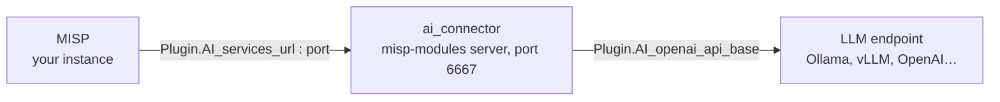

<!--
MISP shows this page in its AI settings (the "Installation guide" of the module status card):
it downloads it from the main branch, shows what precedes the first "## " heading as an
overview, and turns each "## " section into a tab. It opens the "Docker" or the "Standard
install" tab depending on the host it runs on, and a link to "#<section>" switches tabs there.
Keep those section titles, and no "## " line inside a code block: tests/test_docs_unit.py
checks both.
-->

# Install ai_connector next to MISP

MISP's AI actions — summarise an event or a report, recommend tags, extract indicators — are
carried out by **ai_connector**, a module the stock misp-modules does not ship. It runs on a
misp-modules server of its own, between MISP and the language model:



> [!NOTE]
> MISP never calls the model itself: it sends the endpoint, key and model to the module with
> every request, and the module makes the call. The model has to be reachable **from the
> module**, not from MISP or from your browser.

Three steps:

1. **Install the module** — with [Docker](#docker) next to a misp-docker stack, or as a
   [standard install](#standard-install) on the MISP host.
2. **Connect a model** — point the module at an [LLM endpoint](#llm-endpoint) and test it.
3. **Check** — the status card of MISP's *AI* settings tab turns green link by link. One stays
   red? See [Troubleshooting](#troubleshooting).

Developing the module or running its tests rather than serving MISP? Install it from a
checkout instead: [OPERATOR_GUIDE.md §1.2](OPERATOR_GUIDE.md#12-install).

## Docker

This assumes the official [misp-docker](https://github.com/MISP/misp-docker) stack: a
directory holding `docker-compose.yml` and `.env`. The module gets a container of its own,
built from the misp-modules image the stack already runs, on the stack's network. Nothing has
to be cloned: Docker fetches the module's code from GitHub while building the image. Every
command runs from the directory that holds `docker-compose.yml`.

### 1. Declare the service

Create `docker-compose.ai-connector.yml` next to `docker-compose.yml`:

```yaml
services:
  ai-connector:
    image: misp-ai-connector:local
    build:
      context: https://github.com/MISP/ai-connector.git#main
      dockerfile_inline: |
        FROM ghcr.io/misp/misp-docker/misp-modules:${MODULES_RUNNING_TAG:-latest}
        COPY . /ai-connector
        RUN cp -r /ai-connector /tmp/build && pip install --no-cache-dir /tmp/build && rm -rf /tmp/build
    # The image's entrypoint is already misp-modules: only its arguments here.
    command: ["-l", "0.0.0.0", "-p", "6667", "-c", "/ai-connector"]
    restart: always
    extra_hosts:
      - "host.docker.internal:host-gateway"
    healthcheck:
      test: "/bin/bash -c '</dev/tcp/localhost/6667'"
      interval: 10s
      timeout: 1s
      retries: 3
      start_period: 10s
```

What each part is for:

- `context` is this repository: the build fetches it, so there is no checkout to keep. To pin
  a version, replace `#main` with a commit id.
- The image starts from the misp-modules image of your stack (`MODULES_RUNNING_TAG`, read from
  `.env`), adds the module's code and installs its dependencies. The copy in `/tmp` is there
  because pip needs a writable source directory, and the image does not run as root.
- `-c /ai-connector` makes misp-modules load the module; `-p 6667` keeps it apart from the
  enrichment server, which listens on 6666.
- `extra_hosts` lets the module reach an LLM served on the Docker host itself, as
  `http://host.docker.internal:<port>`. Drop it if the LLM runs elsewhere.
- `dockerfile_inline` needs Docker Compose 2.17 or later (`docker compose version`).

> [!WARNING]
> There is no `ports:` entry, on purpose. MISP reaches the module over the stack's network.
> `/query` has no authentication and runs model calls, with the key MISP sends, for anyone who
> can reach it: do not publish it on the host.

### 2. Have Compose load it

Add this line to the stack's `.env`:

```dotenv
COMPOSE_FILE=docker-compose.yml:docker-compose.ai-connector.yml
```

Every `docker compose` command run in this directory now includes the new service, while
`docker-compose.yml` stays as misp-docker ships it: updating misp-docker never conflicts with
your change.

> [!IMPORTANT]
> If the stack also has a `docker-compose.override.yml`, add it to the list. Once
> `COMPOSE_FILE` is set, Compose stops loading that file on its own.

### 3. Build and start it

```bash
docker compose up -d --build ai-connector
docker compose ps ai-connector
```

After a few seconds the status reads `healthy`. *no such service* means the `COMPOSE_FILE`
line of step 2 is missing.

### 4. Check that MISP can reach it

```bash
docker compose exec misp-core curl -s http://ai-connector:6667/healthcheck
docker compose exec misp-core sh -c "curl -s http://ai-connector:6667/modules | jq -r '.[] | select(.name==\"ai_connector\") | .meta.version'"
```

The first command prints `{"status":true}`, the second the module's version. If the second
prints nothing, the server is up but did not load the module: read
`docker compose logs ai-connector` (see [Troubleshooting](#troubleshooting)).

### 5. Point MISP at the module

Set the three settings on the *AI* settings tab, or from the command line:

```bash
docker compose exec --user www-data misp-core /var/www/MISP/app/Console/cake Admin setSetting Plugin.AI_services_url http://ai-connector
docker compose exec --user www-data misp-core /var/www/MISP/app/Console/cake Admin setSetting Plugin.AI_services_port 6667
docker compose exec --user www-data misp-core /var/www/MISP/app/Console/cake Admin setSetting Plugin.AI_services_enable true
```

`http://ai-connector` is the service's name on the stack's network. The default,
`http://127.0.0.1`, points at the misp-core container itself, where nothing listens on 6667.

Reload the *AI* settings tab: the status card now shows the module as loaded, with its
version. Continue with the [LLM endpoint](#llm-endpoint).

### 6. Keep it up to date

```bash
docker compose build --no-cache ai-connector
docker compose up -d ai-connector
```

The first command fetches the repository again. The container keeps no state: recreating it
loses nothing. To see what the module is doing: `docker compose logs -f ai-connector`.

## Standard install

This assumes MISP installed on a Debian or Ubuntu host from the official install scripts, with
the web server running as `www-data` and MISP in `/var/www/MISP`. The module runs under its own
system user, from `/opt/ai-connector`, as a systemd service listening on `127.0.0.1:6667`.

### 1. Create a user and get the code

```bash
sudo apt-get install -y git curl jq
sudo useradd --system --create-home --home-dir /var/lib/misp-ai --shell /usr/sbin/nologin misp-ai
sudo install -d -o misp-ai -g misp-ai /opt/ai-connector
sudo -u misp-ai git clone https://github.com/MISP/ai-connector.git /opt/ai-connector
```

### 2. Install Python and the module

The module needs Python 3.14 or later. [uv](https://docs.astral.sh/uv/) fetches it without
touching the system Python, so this works on any recent distribution.

```bash
curl -LsSf https://astral.sh/uv/install.sh | sudo env UV_INSTALL_DIR=/usr/local/bin sh
cd /opt/ai-connector
sudo -u misp-ai -H uv venv --python 3.14 .venv
sudo -u misp-ai -H uv pip install --python .venv/bin/python -e ".[e2e]"
```

The `e2e` extra brings the misp-modules server along with the module's own dependencies.

### 3. Run it as a service

```bash
sudo tee /etc/systemd/system/misp-ai-connector.service > /dev/null <<'UNIT'
[Unit]
Description=MISP AI module (ai_connector on misp-modules)
After=network-online.target
Wants=network-online.target

[Service]
User=misp-ai
Group=misp-ai
WorkingDirectory=/opt/ai-connector
ExecStart=/opt/ai-connector/.venv/bin/python -m misp_modules -c /opt/ai-connector -l 127.0.0.1 -p 6667
Restart=on-failure

[Install]
WantedBy=multi-user.target
UNIT
sudo systemctl daemon-reload
sudo systemctl enable --now misp-ai-connector
```

> [!NOTE]
> Always pass `-p 6667`: misp-modules defaults to 6666, the port of the enrichment server MISP
> already runs.

### 4. Check that it answers

```bash
curl -s http://127.0.0.1:6667/healthcheck
curl -s http://127.0.0.1:6667/modules | jq -r '.[] | select(.name=="ai_connector") | .meta.version'
```

The first command prints `{"status":true}`, the second the module's version. If the second
prints nothing, read `journalctl -u misp-ai-connector` (see [Troubleshooting](#troubleshooting)).

### 5. Point MISP at the module

Set the three settings on the *AI* settings tab, or from the command line:

```bash
sudo -u www-data /var/www/MISP/app/Console/cake Admin setSetting Plugin.AI_services_url http://127.0.0.1
sudo -u www-data /var/www/MISP/app/Console/cake Admin setSetting Plugin.AI_services_port 6667
sudo -u www-data /var/www/MISP/app/Console/cake Admin setSetting Plugin.AI_services_enable true
```

Reload the *AI* settings tab: the status card now shows the module as loaded, with its
version. Continue with the [LLM endpoint](#llm-endpoint).

> [!WARNING]
> **The module on another host.** Replace `-l 127.0.0.1` in the unit with the address MISP
> reaches it on, set `Plugin.AI_services_url` to `http://<that address>`, and let only the MISP
> host through the firewall, for instance with
> `sudo ufw allow from <MISP host IP> to any port 6667 proto tcp`: `/query` has no
> authentication.

### 6. Keep it up to date

```bash
cd /opt/ai-connector
sudo -u misp-ai git pull
sudo -u misp-ai -H uv pip install --python .venv/bin/python -e ".[e2e]"
sudo systemctl restart misp-ai-connector
```

To see what the module is doing: `journalctl -u misp-ai-connector -f`.

## LLM endpoint

Three settings on MISP's *AI* settings tab tell the module which model to use. MISP sends them
with every request, so nothing has to be configured on the module's side.

| setting | what to put in it |
|---|---|
| `Plugin.AI_openai_api_base` | the endpoint's OpenAI-compatible root, ending in `/v1` |
| `Plugin.AI_model_id` | a model that endpoint serves, spelled exactly as it lists it |
| `Plugin.AI_api_key` | the endpoint's key; leave it empty for a local Ollama |

> [!IMPORTANT]
> The URL must be reachable **from the module**, not from MISP or from your browser.

### Common setups

| where the model runs | `AI_openai_api_base` | notes |
|---|---|---|
| Ollama on the same host (standard install) | `http://127.0.0.1:11434/v1` | `ollama pull <model>` first |
| Ollama on the Docker host | `http://host.docker.internal:11434/v1` | needs the service's `extra_hosts` line, and Ollama listening beyond loopback: `OLLAMA_HOST=0.0.0.0` |
| Ollama or vLLM on a GPU server | `http://<gpu-host>:11434/v1` (Ollama) or `http://<gpu-host>:8000/v1` (vLLM) | open the port to the module's host only |
| A commercial API | the provider's base URL, e.g. `https://api.openai.com/v1` | set `AI_api_key`; event content then leaves your network |

To list the models an endpoint serves:

```bash
curl -s http://127.0.0.1:11434/v1/models | jq -r '.data[].id'
```

### Test it

Press **Test LLM** on the status card. It asks the module to reach the endpoint and check the
model, and shows the endpoint, the model and the latency. A failure here is between the module
and the LLM: see [Troubleshooting](#troubleshooting).

### Give users the AI actions

The AI actions appear for users whose role has the **AI tools** permission (`perm_ai_tools`):
open MISP's *Roles* page (`/roles/index`), edit the role, tick *AI tools*. They then find
*AI actions* in the event side menu and a robot button on every event report. Everything the
module produces is tagged `ai-computer-assisted:assistance-level="ai-generated"` and
`ai-computer-assisted:review-level="unreviewed"`.

### Timeouts

Two settings, nested:

- `Plugin.AI_request_timeout` (default 120 s): how long the module waits for **one** call to
  the LLM.
- `Plugin.AI_timeout` (default 300 s): how long MISP waits for the module's whole answer.

A slow model — a large one, or one on CPU — needs both raised; keep `AI_timeout` the larger.

### Tag recommendations (optional)

*Recommend tags* does not use the LLM. It asks
[misp-tag-suggest](https://github.com/ctitools/misp-tag-suggest), a separate service that
learns from the events already tagged on your instance (see
[OPERATOR_GUIDE.md part 3](OPERATOR_GUIDE.md#part-3--connect-the-tag-suggestion-service)).
Once it runs, give its address to the module.

With Docker, in the `ai-connector` service of `docker-compose.ai-connector.yml`, then
`docker compose up -d ai-connector`:

```yaml
    environment:
      - "MISP_TAG_SUGGEST_URL=http://<tag-suggest host>:8000"
      - "MISP_TAG_SUGGEST_API_KEY=<its API key>"
```

With a standard install, in `/opt/ai-connector/.env`, then
`sudo systemctl restart misp-ai-connector`:

```dotenv
MISP_TAG_SUGGEST_URL=http://<tag-suggest host>:8000
MISP_TAG_SUGGEST_API_KEY=<its API key>
```

Without it, the other AI actions work and tag recommendation answers with an error.

## Troubleshooting

Start from what the status card of MISP's *AI* settings tab says.

### "Disabled"

`Plugin.AI_services_enable` is off: MISP does not even try to contact the module, and no AI
action is offered anywhere. Set it to `true`.

### "Unreachable"

MISP could not open a connection to `AI_services_url:AI_services_port`; the card shows the
error it got.

- **Docker:** the URL must be the service name, `http://ai-connector`. Check that the container
  runs with `docker compose ps ai-connector`, and that MISP sees it with step 4 of
  [Docker](#docker).
- **Standard install:** check `systemctl status misp-ai-connector`, and that something listens
  on the port with `ss -ltnp | grep 6667`.
- An `https://` URL brings MISP's `Plugin.AI_ssl_*` settings into play; the module itself
  serves plain HTTP unless a reverse proxy sits in front of it.

### "Not offered" (module missing)

A misp-modules server answered, but it does not offer ai_connector.

- **Wrong port.** On 6666 you reach the enrichment server, which never has it. Set
  `Plugin.AI_services_port` to 6667.
- **The module failed to load.** misp-modules skips a module it cannot import and keeps
  running. The reason is in the logs (`docker compose logs ai-connector` or
  `journalctl -u misp-ai-connector`): usually a missing dependency or a PyMISP older than
  `pyproject.toml` asks for. Rebuild the image, or re-run step 2 of the
  [standard install](#standard-install).
- **Wrong directory.** `-c` must point at the module's root, the directory that contains
  `expansion/` and `genai/`: `/ai-connector` in the Docker image, `/opt/ai-connector` for a
  standard install.

### "Test LLM" fails

MISP reaches the module, but the module does not get an answer from the LLM.

- **Connection refused or timed out:** the URL is not reachable from the module. Inside Docker,
  `127.0.0.1` is the container itself: use `host.docker.internal`, a service name or the
  server's address. An Ollama on the host must listen beyond loopback (`OLLAMA_HOST=0.0.0.0`).
- **Model not found:** `AI_model_id` does not match what the endpoint lists. Compare it with
  the `/v1/models` call of [LLM endpoint](#llm-endpoint), or `ollama pull` the model.
- **401 / 403:** `AI_api_key` is missing or wrong.

### The AI actions time out

The model is slower than the timeouts allow. Raise `Plugin.AI_request_timeout` and
`Plugin.AI_timeout` (see [LLM endpoint](#llm-endpoint), *Timeouts*), or use a smaller model.

### Users do not see the AI actions

Either the AI services are disabled, or the user's role lacks the *AI tools* permission.

Everything else about running the module — every setting, its metrics, logs, capacity and
failure modes — is in the [operator guide](OPERATOR_GUIDE.md).
